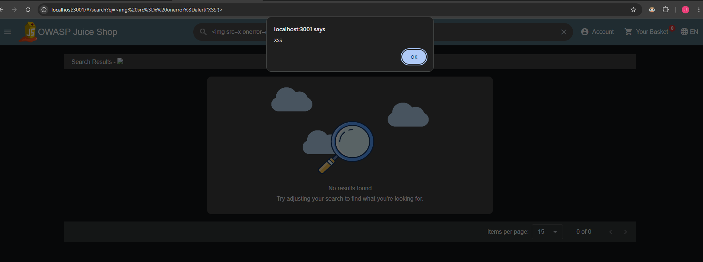
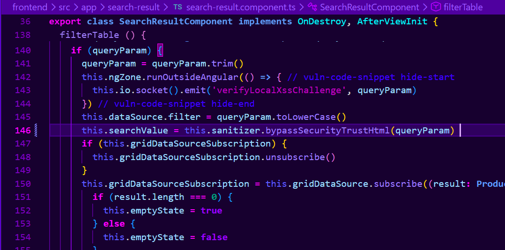
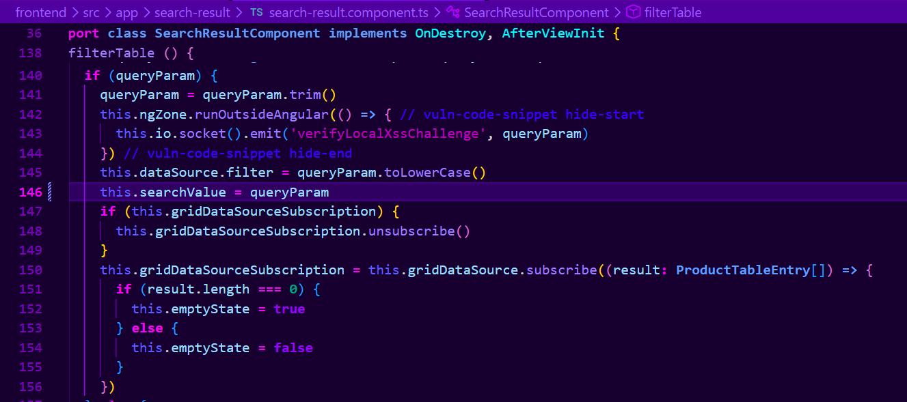
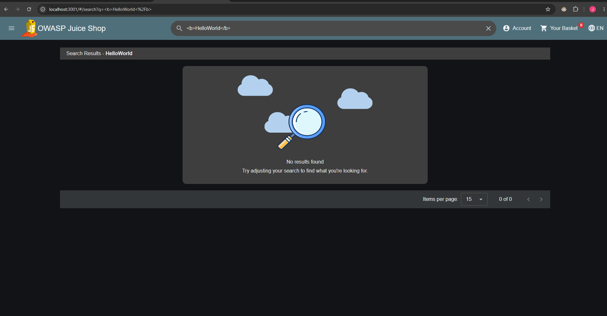

# DOM-Based Cross-Site Scripting (XSS) Remediation

## Which vulnerability was found?

A Cross-Site Scripting attack is a possibility when a website does not “sanitize” input from users. What is meant by that is, the website does not remove or neutralize potentially dangerous content before the browser interprets it. If an attacker puts certain JavaScript commands into, in this instance a search bar, those commands can be executed on the web page. This allows an attacker to execute unauthorized JavaScript, which could compromise user information or manipulate the website’s behavior.

When an application has a search bar and a user inputs something into Juice Shop’s search bar, the query becomes part of the URL. What Juice Shop did was take that query from the URL and run it through a function called bypassSecurityTrustHtml(), which told Juice Shop’s front-end program, Angular, to trust any input as safe HTML. This allowed the application to insert the HTML into the web page, which then executed the malicious JavaScript.

OWASP Top 10:2025 – A05 Injection


## How to reproduce the vulnerability

If a person were going to reproduce this attack on the Juice Shop application they would have to use a platform like Docker to open the program. Juice Shop would be opened on the local host machine, in my instance it was http://localhost:3000. There is a search bar where a malicous JavaScript could be entered as a search query. The search query I used was ``. When I submitted the search query an alert box was triggered on the web page which should not have happened.




## Explanation of the root cause

The root cause of this vulnerability is a function that allows the query to bypass Angular's HTML sanitization. Code file page in the Juice Shop program is called search-result.component.ts.  There is a function in that file on line 146 called filterTable() which calls on this line, ```this.searchValue = this.sanitizer.bypassSecurityTrustHtml(queryParam)``` to allow the query to be treated as trusted content.


## How to fix this issue

This was a fairly easy and straitforward fix. I removed the ```this.sanitizer.bypassSecurityTrustHtml(queryParam)``` and replaced it with ```queryParam```. This would allow the normal built-in protections to sanitize the input when displaying the search results while preventing malicious JavaScript from executing.

Another option would have been to change the HTML file to display the search query as plain text instead of HTML, which would prevent the browser from executing the malicious code.


## Fix process/Implementation\

I removed the original code that bypassed the sanitizer:


and replaced it with just the parameter:


Commit: https://github.com/beaudoit/CS467-Juice-Shop/commit/bfc08d822


## Verification of the fix

Before the fix an alert window opened with the text I placed into the query:


After the fix there was no alert and the query was displayed correctly:


After applying the fix, I also searched for a known product using the term ```apple``` and confirmed that the search functionality worked as expected.


## Potential Improvements

Regression Testing: An automated test could run whenever code changes are submitted to ensure the XSS vulnerability has not been reintroduced. If the vulnerability returns, the test would fail and notify developers.

Review for similar code: A search of the entire directory could reveal other places where ```bypassSecurityTrustHtml()``` is used. Each instance could be reviewed to determine whether bypassing the built-in protections is necessary and safe.


## References

OWASP. OWASP Top 10:2025 — A05 Injection. https://owasp.org/Top10/2025/A05_2025-Injection/

OWASP. DOM Based XSS Prevention Cheat Sheet. https://cheatsheetseries.owasp.org/cheatsheets/DOM_based_XSS_Prevention_Cheat_Sheet.html

Angular. DomSanitizer API Documentation. https://angular.dev/api/platform-browser/DomSanitizer

OWASP. Juice Shop GitHub Repository. https://github.com/juice-shop/juice-shop

OpenAI. (2026). ChatGPT (GPT-6). Used for technical explanations, troubleshooting, and proofreading.