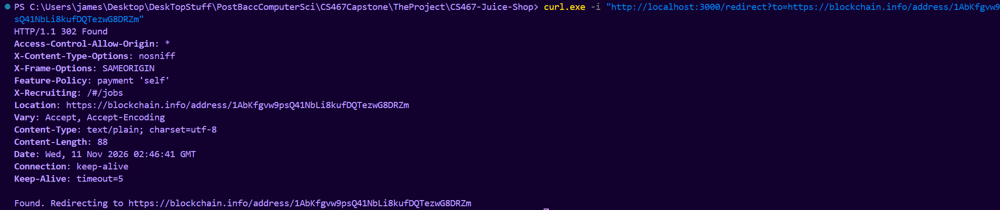
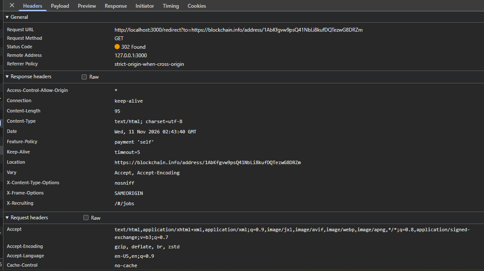
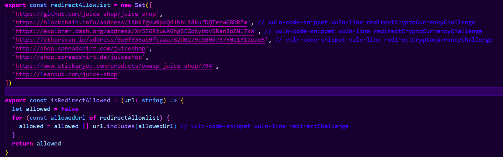
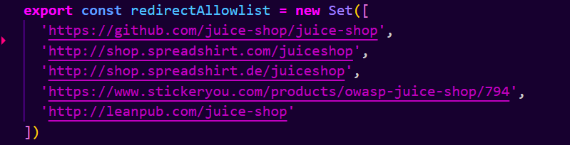
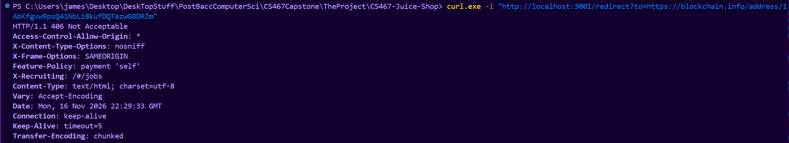
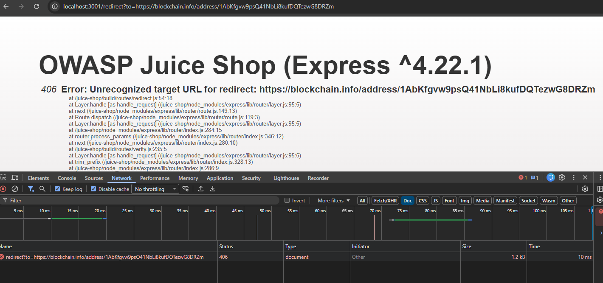

# Outdated Allowlist Remediation

## Which vulnerability was found?

The vulnerability I found in OWASP Juice Shop was an outdated redirect allowlist. An allowlist is basically a list of approved websites that an application is allowed to send users to. The problem is that when websites are no longer needed, they should be removed from that list. Otherwise, the application will continue treating them as trusted destinations.

In Juice Shop, there were three cryptocurrency websites still included in the redirect allowlist even though the payment options associated with them had been disabled. The buttons were no longer available to users, but the application would still redirect someone to those websites if they entered the correct URL.

This creates a security risk because just removing something from the website doesn't mean the underlying functionality has been removed. If one of those old websites were compromised or taken over, users could potentially be redirected to a malicious website that Juice Shop still considers safe.

OWASP Top 10:2025 - A02 Security Misconfiguration

## How to reproduce the vulnerability

To reproduce this vulnerability, I used Docker to run the original version of OWASP Juice Shop on localhost port 3000. I then used PowerShell and Google Chrome to test whether the application would still redirect users to one of the cryptocurrency websites that had been removed from the payment interface.

### Steps to Reproduce the Outdated Allowlist Vulnerability

1. Start the original, vulnerable version of OWASP Juice Shop using Docker.
2. Open PowerShell and enter the following command:
    ```powershell
    curl.exe -i "http://localhost:3000/redirect?to=https://blockchain.info/address/1AbKfgvw9psQ41NbLi8kufDQTezwG8DRZm"
    ```
3. Examine the HTTP response. The application returns `302 Found`, indicating that it accepted the redirect request.
4. Open Google Chrome and enter the same URL in the address bar.
5. Open Chrome Developer Tools and select the `Network` tab to examine the redirect response.
6. Observe that Juice Shop redirects the browser to the cryptocurrency website even though the payment option is no longer available through the normal interface.

Expected Result: The application should reject redirect requests to cryptocurrency destinations that are no longer authorized.

Actual Result: The application returns `HTTP 302` and redirects the user to the outdated destination.





## Explanation of the root cause

The root cause of this vulnerability was that three cryptocurrency addresses were still included in the redirect allowlist even though the payment options associated with them had been disabled.

The allowlist is located in `lib/insecurity.ts` and contains the website addresses that Juice Shop is allowed to redirect users to. When a redirect request is made, the application checks whether the destination is approved.

The problem was that the cryptocurrency addresses were still considered approved destinations. The payment buttons had been removed from the user interface, but the developers had not removed the corresponding addresses from the allowlist.

As a result, someone could manually enter a redirect URL and the application would accept it, returning an `HTTP 302` response and sending the user to the outdated destination.



## How to fix this issue

There were a couple of ways to address this vulnerability. One option would have been to modify the redirect validation function to specifically reject the three cryptocurrency websites. Another option was to remove the outdated addresses from the allowlist entirely.

I chose to remove the three addresses from the allowlist in `lib/insecurity.ts`. Since the cryptocurrency payment options were no longer available, there was no reason for Juice Shop to continue allowing redirects to those websites.

This was the simplest solution and required very little modification to the existing code. It also allowed us to keep the legitimate redirects working without making unnecessary changes to the redirect validation function.

## Fix process/implementation

The fix was made in `lib/insecurity.ts`, where the `redirectAllowlist` is defined. I located the three cryptocurrency addresses associated with the disabled payment options and removed them from the list.

The addresses removed were for `Bitcoin (blockchain.info)`, `Dash (explorer.dash.org)`, and `Ethereum (etherscan.io)`. No other addresses were removed, and the redirect validation function was left unchanged.

After saving the changes, I rebuilt the Docker image and restarted the modified version of Juice Shop on localhost port 3001. This allowed me to test the updated application while keeping the original vulnerable version running on port 3000 for comparison.

Commit: [Add link]



## Verification of the fix

After making the changes to the allowlist, I tested the modified version of Juice Shop using PowerShell and Google Chrome. I used the same Bitcoin redirect URL that I had previously tested against the vulnerable application.

Before the fix, Juice Shop returned an HTTP `302 Found` response, allowing the browser to redirect to the cryptocurrency website. After removing the outdated addresses and rebuilding the application, the same request returned Http `406 Not Acceptable`, showing that Juice Shop was now rejecting the redirect.

I also tested the reamining two cryptocurrency addresses for Dash and Etherium. Both returned HTTP `406`, confirming that all three outdated destinations were being rejected.

Finally, I tested a legitimate redirect to the Juice Shop GitHub repository. This request returned HTTP `302 Found`, confirming that the application could still redirect users to an approved destination.

These tests showed that the outdated cryptocurrency redirects were blocked without interfering with the legitimate redirect that I tested.





## Potential Improvements

Although removing the three cryptocurrency addresses fixed this vulnerability, there are still some improvements that could be made to prevent similar problems in the future.

One improvement would be to review the redirect allowlist whenever features are removed or changed. If a feature no longer requires a redirect to an outside website, the associated address should be removed from the allowlist. This would help prevent outdated destinations from remaining trusted.

Another improvement would be to add automated tests that check whether removed destinations are still accepted. These tests could run whenever changes are made to the application and help identify situations where an outdated address was accidentally left in the allowlist.

Finally, the remaining addresses in the allowlist should be reviewed periodically to make sure they are still necessary and point to the intended websites.

## References

OWASP. OWASP Juice Shop GitHub Repository. https://github.com/juice-shop/juice-shop

OWASP. Unvalidated Redirects and Forwards Cheat Sheet. https://cheatsheetseries.owasp.org/cheatsheets/Unvalidated_Redirects_and_Forwards_Cheat_Sheet.html

OWASP. OWASP Top 10:2025 — A02 Security Misconfiguration. https://owasp.org/Top10/2025/A02_2025-Security_Misconfiguration/

OpenAI. (2026). ChatGPT (GPT-6). Used for technical explanations, troubleshooting, and proofreading.