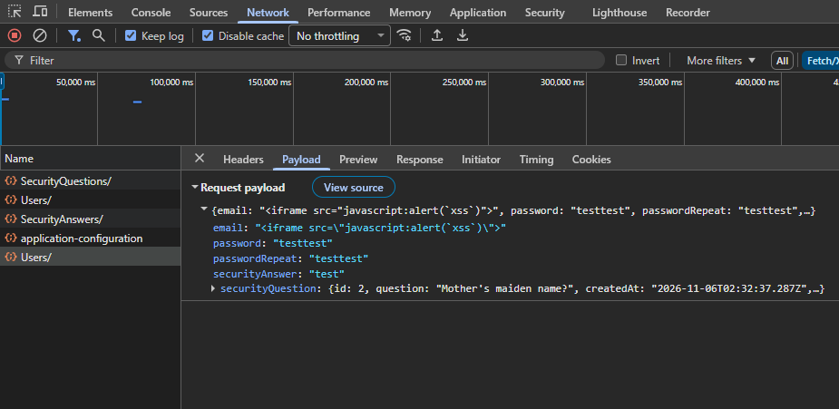
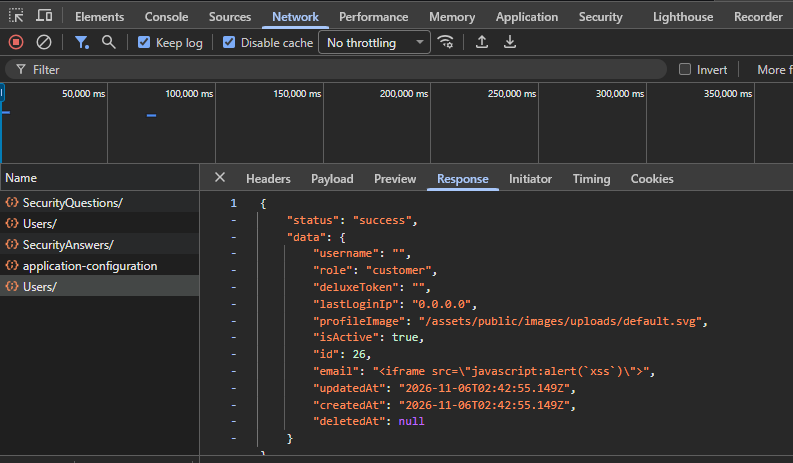
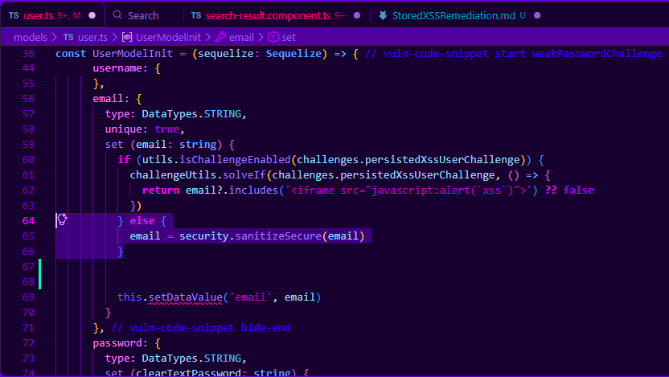
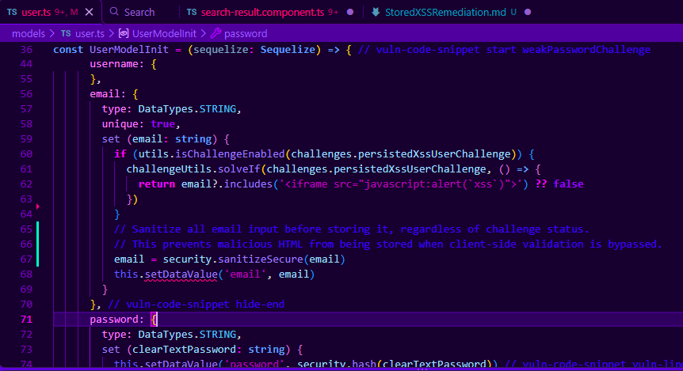
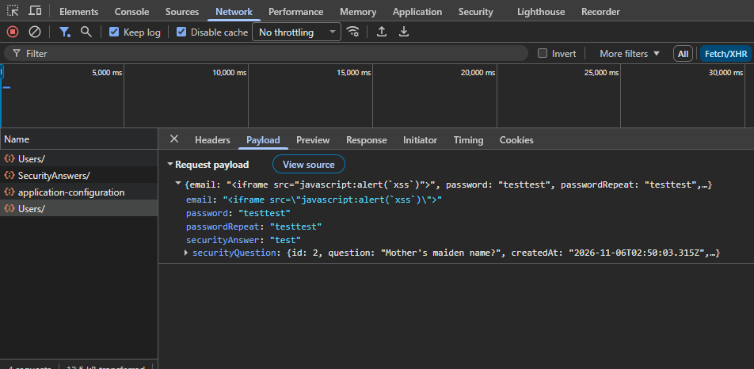
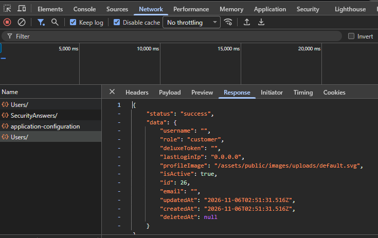

# Stored Cross-Site Scripting (XSS) Remediation

## Which vulnerability was found?

A stored Cross-Site Scripting (XSS) vulnerability was identified in the user registration process of OWASP Juice Shop. Unlike DOM-based XSS, where malicious JavaScript can execute directly from user input in the browser, stored XSS occurs when malicious content is saved by the application and can later be executed when that content is displayed on a web page.

In this instance, the vulnerability was located in the email field of the user registration process. Normally, the application should sanitize the email address before storing it in the database. However, the code contained a conditional statement that allowed the sanitization process to be bypassed when the stored XSS challenge was enabled.

Using the browser's Developer Tools, an attacker could bypass the registration form's client-side validation by modifying and resending the registration request with malicious HTML inserted into the email field. Because the application did not consistently sanitize this input on the server, the malicious content could be stored in the database. If that content were subsequently displayed in an unsafe manner, it could execute JavaScript in another user's browser.

OWASP Top 10:2025 – A05 Injection

## How to reproduce the vulnerability

To reproduce the stored XSS vulnerability, I used Docker to run the vulnerable version of OWASP Juice Shop on `http://localhost:3000`. I then used Google Chrome's Developer Tools to modify a user registration request and bypass the application's client-side email validation.

The malicious payload used for this test was:

```html
<iframe src="javascript:alert(`xss`)">
```

### Steps to Reproduce the Stored XSS Vulnerability

1. Start the vulnerable version of OWASP Juice Shop using Docker with the stored XSS challenge enabled.

2. Open Google Chrome and navigate to `http://localhost:3000`.

3. Open the registration page and press **F12** to launch Chrome Developer Tools.

4. Select the **Network** tab and submit a registration request using a valid email address and the required registration information.

5. Locate the registration request in the Network tab. The request is sent to the application's `/api/Users/` endpoint.

6. Right-click the request and select **Copy as fetch**. Open the **Console** tab and paste the copied request.

7. Modify the `email` field in the request body, replacing the original email address with the malicious iframe payload.

8. Execute the modified `fetch()` request in the Console. This sends the malicious email directly to the server without going through the registration form's validation.

9. Examine the server's response in Developer Tools. The vulnerable application returns the malicious HTML in the registered user's email field, demonstrating that the input was accepted and stored without being sanitized.

Expected Result: The application should sanitize or reject malicious HTML submitted through the email field before storing it in the database.

Actual Result: The vulnerable application accepts the malicious HTML and stores it as part of the user's email address.

The following screenshot show the makicious iframe payload submitted through the registration request:


The server accepted the malicious HTML and returned it in the email field:


## Explanation of the root cause

The root cause of this vulnerability was located in the `models/user.ts` file of the Juice Shop application. The file contains a setter function responsible for processing the user's email address before storing it in the database.

The original code used a conditional statement to determine whether the stored XSS challenge was enabled. When the challenge was enabled, the application checked whether the email address contained the malicious iframe payload. However, the sanitization function, `security.sanitizeSecure(email)`, was located inside the `else` statement.

This meant that when the challenge was enabled, the application skipped sanitization entirely and passed the untrusted email address to `this.setDataValue('email', email)`. As a result, malicious HTML could be stored in the database without being sanitized.

The problem was that the application only sanitized the email address when the stored XSS challenge was disabled. When the challenge was enabled, the malicious code could be stored without being sanitized.

## How to fix this issue

The fix for this vulnerability was fairly straightforward. The original code only sanitized the email address when the stored XSS challenge was disabled. I moved `security.sanitizeSecure(email)` outside of the `else` statement so that the email address would always be sanitized before being stored in the database.

This change allows the application to continue checking whether the stored XSS challenge is enabled, but it no longer skips sanitization when the challenge is active. The email address is now sanitized before it reaches `this.setDataValue('email', email)`, regardless of whether the challenge is enabled or disabled.

Another option would have been to add additional server-side validation to reject email addresses containing HTML or JavaScript. However, moving the existing sanitization function was a simpler solution because the application already had the function needed to prevent the malicious code from being stored.

## Fix process/Implementation

I opened the `models/user.ts` file in Visual Studio Code and located the setter function for the user's email address.

In the original code, `security.sanitizeSecure(email)` was inside the `else` statement. This meant that the email address was only sanitized when the stored XSS challenge was disabled.

The original code:



I removed the `else` statement and moved `security.sanitizeSecure(email)` below the challenge check. This ensures that the email address is sanitized before being stored, whether the challenge is enabled or not.

The corrected code:



Commit: [Add commit link here]

## Verification of the fix

To verify that the fix worked, I tested the same malicious code against both versions of Juice Shop. The original vulnerable application was running on `http://localhost:3000`, and the modified application was running on `http://localhost:3001`.

Before the fix, I submitted the malicious iframe through Chrome Developer Tools. The server accepted the request and returned the malicious code in the email field.


After applying the fix, I submitted the same malicious code to the modified application. This time, the server removed the malicious content, and the email field in the response was empty.





These results show that the fix prevents the malicious HTML from being stored through the registration process, even when the stored XSS challenge is enabled.

## Potential Improvements

Regression Testing: An automated test could be added to make sure the stored XSS vulnerability does not return in future updates. The test could submit malicious HTML through the registration process and verify that the application does not store it.

Additional Input Validation: The application could also check email addresses on the server to make sure they follow a valid email format. This would provide another layer of protection by rejecting invalid email addresses instead of relying only on sanitization.

Review Other Input Fields: Other fields in the application could be reviewed to make sure they properly sanitize user input before storing it. This could help identify similar vulnerabilities elsewhere in Juice Shop.

## References

OWASP. OWASP Top 10:2025 — A05 Injection. https://owasp.org/Top10/2025/A05_2025-Injection/

OWASP. Cross Site Scripting Prevention Cheat Sheet. https://cheatsheetseries.owasp.org/cheatsheets/Cross_Site_Scripting_Prevention_Cheat_Sheet.html

OWASP. Juice Shop GitHub Repository. https://github.com/juice-shop/juice-shop

OpenAI. (2026). ChatGPT (GPT-6). Used for technical explanations, troubleshooting, and proofreading.