# Unvalidated Redirects Remediation

## Which Vulnerability Was Found?

The OWASP Juice Shop application contained an unvalidated redirect vulnerability that allowed an attacker to redirect users to an unauthorized website. The vulnerability was located in the `/redirect` endpoint, which uses the `to` query parameter to determine the destination URL.

The original validation function checked whether the supplied URL contained any URL from an approved allowlist. Because the function only searched for matching text rather than validating the actual destination, an attacker could include an approved URL within a malicious URL and bypass the security check.

This vulnerability could be exploited to send users to external websites that were not approved by the application. An attacker could potentially use this behavior in phishing attacks by directing users away from a trusted application to a malicious website.

OWASP Top 10:2025 - A01 Broken Access Control

## How to reproduce the vulnerability

To reproduce this vulnerability, we used Docker Desktop to run the original version of OWASP Juice Shop on `localhost:3000`. We tested the redirect through Chrome by entering a URL that pointed to an unauthorized website but also contained an approved GitHub address. The application allowed the redirect, and Chrome navigated to `example.com`. We also used PowerShell to examine the HTTP response and confirm that the server returned a `302 Found` status with the unauthorized destination in the `Location` header.

### Steps to Reproduce the Unvalidated Redirect Vulnerability

1. Start the original, vulnerable version of OWASP Juice Shop using Docker Desktop.

2. Open Google Chrome and navigate to `http://localhost:3000` to confirm that Juice Shop is running.

3. Enter the following URL into Chrome's address bar:

   ```text
   http://localhost:3000/redirect?to=https://example.com/?next=https://github.com/juice-shop/juice-shop
   ```

   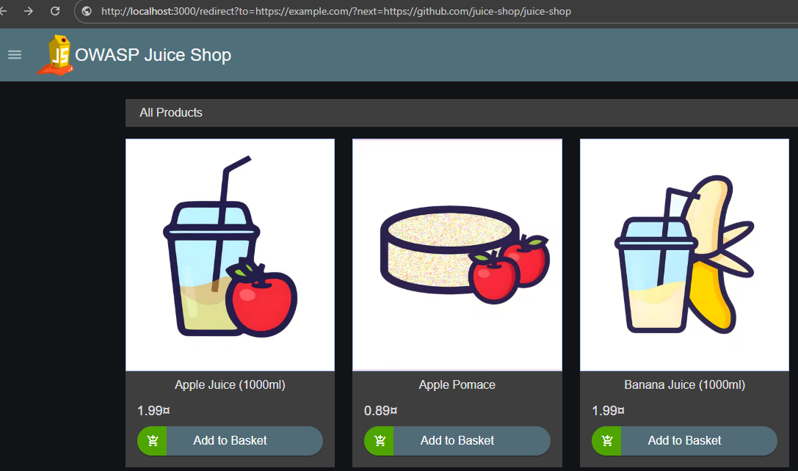

4. Press Enter. The vulnerable application accepts the request and redirects Chrome to `example.com`, even though it is not an approved destination.

5. Confirm that Chrome's address bar now shows `example.com/?next=https://github.com/juice-shop/juice-shop`.

   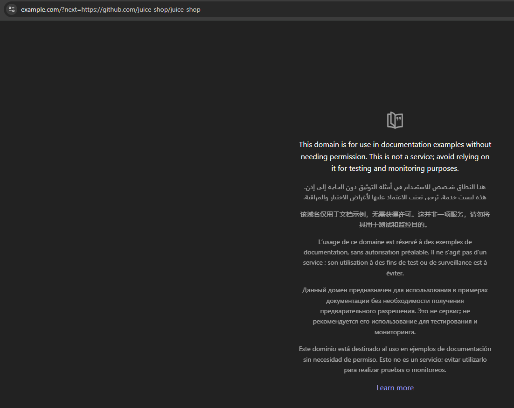

6. Open PowerShell and send the same request using `curl.exe`:

   ```powershell
   curl.exe -I "http://localhost:3000/redirect?to=https://example.com/?next=https://github.com/juice-shop/juice-shop"
   ```

7. Examine the response. The server returns HTTP `302 Found`, with a `Location` header pointing to the unauthorized `example.com` address.

Expected Result: The application should reject redirects to unauthorized websites, even when the requested URL contains an approved address.

Actual Result: The vulnerable application accepts the request and redirects the browser to `example.com`.

## Explanation of the Root Cause

The root cause of this vulnerability was in the `isRedirectAllowed()` function located in `lib/insecurity.ts`. This function was responsible for checking whether a requested redirect was going to an approved website.

The original code used the JavaScript `includes()` method to compare the requested URL against the list of approved addresses.

```typescript
allowed = allowed || url.includes(allowedUrl)
```

The problem was that `includes()` only looked for matching text. It did not check whether the actual destination matched an approved website. An attacker could place an approved URL inside the query string of another website, and the function would still allow the redirect.

In our test, we used `example.com` as the destination and included the approved Juice Shop GitHub address in the URL. Because the GitHub address was present, the function returned `true` and allowed the redirect to an unauthorized website.

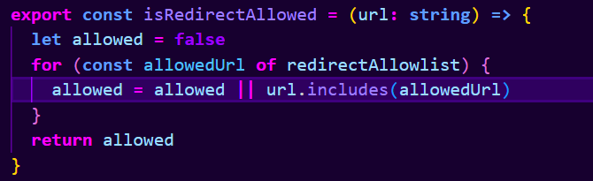

## How to fix this issue

To fix this vulnerability, we needed to change how the application checked redirect destinations. The original function only looked for approved text within the URL, so we replaced that check with one that examines the actual address.

We decided to use JavaScript's `URL` class to separate the different parts of the requested address. This allowed us to compare the destination's origin and path against the approved URLs. Both have to match the requirements before a redirect is allowed.

### Steps to Fix the Unvalidated Redirect Vulnerability

1. Open the OWASP Juice Shop project in Visual Studio Code.

2. In the Explorer panel, navigate to `lib/insecurity.ts`.

3. Locate the `isRedirectAllowed()` function.

4. Add the `URL` import from `node:url` at the top of the file.

5. Replace the original `includes()` check with URL parsing. Use a `try/catch` block so that an invalid URL returns `false` instead of causing an error.

6. For each URL in the existing allowlist, compare its origin with the requested destination's origin. This checks that the protocol, hostname, and port match.

7. Compare the destination's path against the approved path. Allow an exact match or a subpath beneath the approved path.

8. Only allow the redirect when both the origin and path checks pass.

9. Save the file, then rebuild and restart the modified Juice Shop application so the changes take effect.

10. Test the malicious redirect again and verify that the server returns HTTP `406 Not Acceptable`.

11. Test an approved redirect and confirm that it still returns HTTP `302 Found` with the correct destination.

Expected Result: The application rejects unauthorized redirect destinations while continuing to allow approved URLs.

Another possible solution would have been to require every redirect URL to exactly match an entry in the allowlist. This would have been more restrictive, but it would also have blocked legitimate subpaths, such as the approved GitHub repository's `/issues` page. We chose to allow approved subpaths so that the existing functionality would continue working.

## Fix Process/Implementation

We removed the original validation that used `includes()` to check whether the requested URL contained an approved address. The original code is shown below:


We replaced it with a function that parses the requested URL and compares its origin and path against the approved addresses. If the URL is invalid or does not meet both requirements, the function returns `false` and the redirect is rejected.

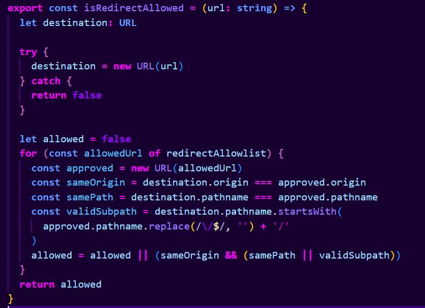

We also added a regression test in `test/server/insecurity.unit.test.ts` to make sure a URL containing an approved address could not bypass the validation again.

Commit: https://github.com/beaudoit/CS467-Juice-Shop/commit/cbb0560ce

## Verification of Fix

After making the changes, we rebuilt the Juice Shop application and tested the redirect function again. We kept the original vulnerable application running on port 3000 and the updated application on port 3001 so we could compare the results.

### Testing the Malicious Redirect

Before the fix, we entered the malicious redirect URL into Chrome using the original Juice Shop application. The browser left Juice Shop and opened `example.com`, even though that website was not on the approved list. This demonstrated that the original application allowed an unauthorized redirect.


After applying the fix, we entered the same URL into Chrome using port 3001. This time, the application displayed an HTTP `406 Not Acceptable` error instead of redirecting to `example.com`. The browser remained on the Juice Shop server, showing that the unauthorized redirect was blocked.

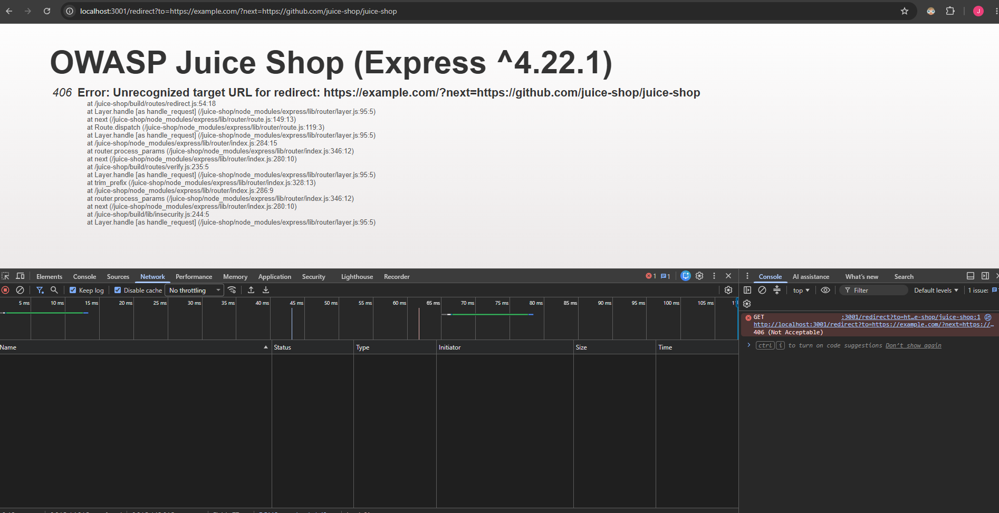

We also used PowerShell and `curl.exe` to compare the HTTP responses from both versions of the application. Before the fix, the server returned HTTP `302 Found`, with a `Location` header pointing to `example.com`. After the fix, the same request returned HTTP `406 Not Acceptable`.

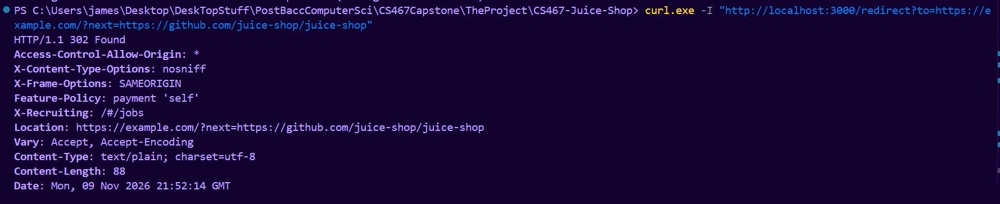

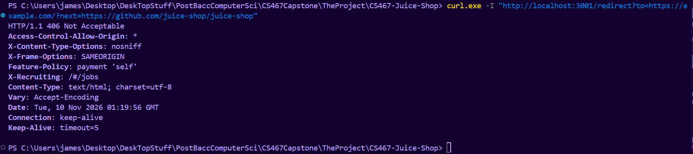

### Testing an Approved Redirect

We tested the same approved URL against both versions of Juice Shop. Both returned HTTP 302 Found with the correct GitHub address in the Location header. This confirmed that our fix blocked unauthorized redirects without interfering with legitimate redirects.

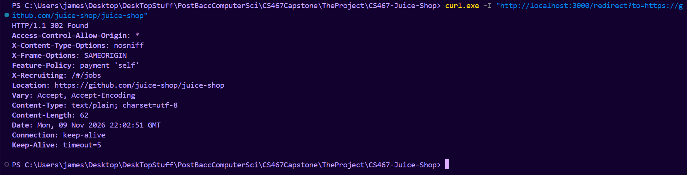

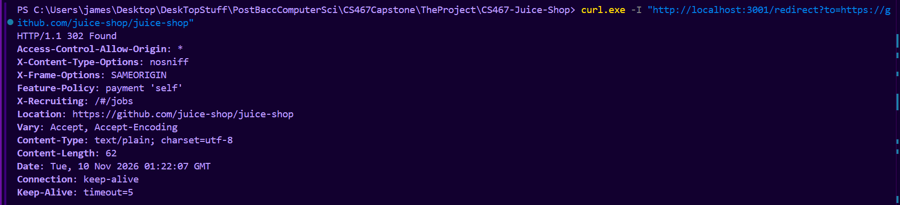

We then tested the approved redirect through Chrome and confirmed that the browser successfully opened the Juice Shop GitHub repository.

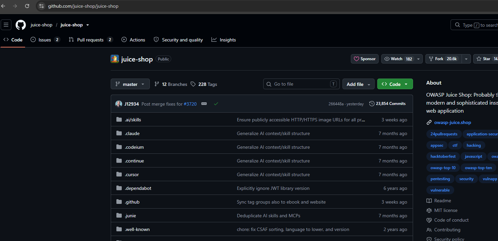

### Unit Testing

In addition to testing the application through Chrome and PowerShell, we ran the existing unit tests for the `isRedirectAllowed()` function and added a new regression test.

The tests checked that approved URLs were accepted, approved subpaths continued to work, unauthorized URLs were rejected, and an unauthorized URL containing an approved address was blocked.

All four tests passed with no failures.

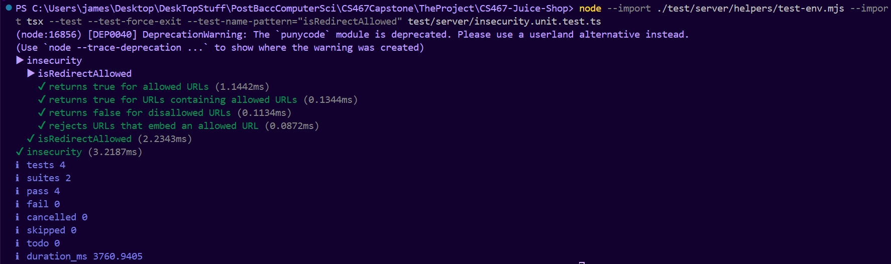

## Potential Improvements

Additional Testing: We added a regression test for the malicious URL used in our original exploit, but there are other ways someone might try to bypass the validation. Additional tests could check URLs with misleading hostnames, unusual characters, or different path structures to make sure the function continues to reject unauthorized destinations.

Stricter Allowlist: Our fix allows redirects to approved URLs and their subpaths. While this keeps legitimate redirects working, it also means that some destinations may be allowed even if they are not specifically listed. We could review the allowlist and restrict redirects to exact URLs where subpaths are not necessary.

Review Similar Code: We could also review other parts of the Juice Shop application that handle redirects or external URLs. This could help identify other places where user-controlled addresses are not being properly validated.

## References

OWASP. OWASP Top 10:2025 — A01 Broken Access Control. https://owasp.org/Top10/2025/A01_2025-Broken_Access_Control/

OWASP. Unvalidated Redirects and Forwards Cheat Sheet. https://cheatsheetseries.owasp.org/cheatsheets/Unvalidated_Redirects_and_Forwards_Cheat_Sheet.html

MDN Web Docs. URL API. https://developer.mozilla.org/en-US/docs/Web/API/URL

OWASP. Juice Shop GitHub Repository. https://github.com/juice-shop/juice-shop

OpenAI. (2026). ChatGPT (GPT-6). Used for technical explanations, troubleshooting, and proofreading.