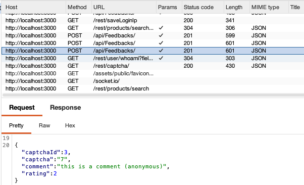
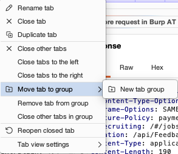
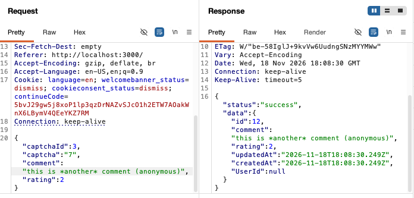
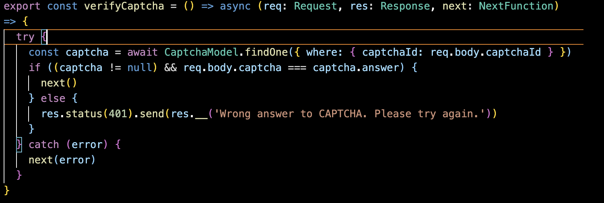
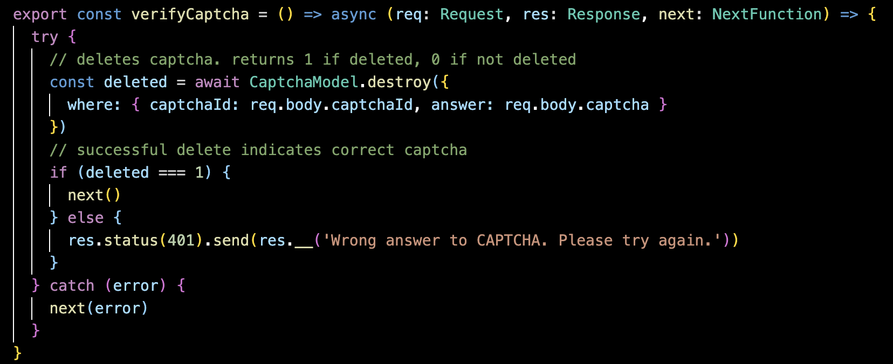
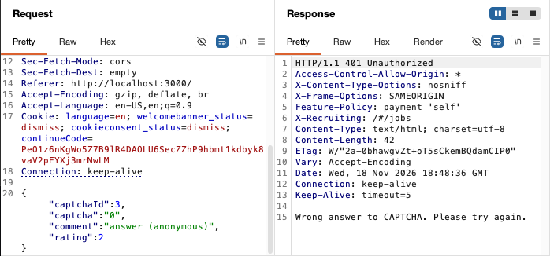

### Which vulnerability was found?

Vulnerability: CAPTCHA Bypass
Category: Broken Anti-Automation
OWASP Top 10:2025 A06:Insecure Design
CWE: CWE-294 (Authentication Bypass by Capture-replay), CWE-799 (Improper Control of Interaction Frequency)

The Juice Shop server does not invalidate a CAPTCHA after it is used, which allows an attacker to submit unlimited automated feedback through the customer feedback form. Bots abusing this vulnerability could spam the shop with fake ratings and comments, which drowns out real inputs from actual users and can also bloat the database with spam. At scale, this could also be used as a DoS vector. 

### How to reproduce the vulnerability
Tool used: BurpSuite free community edition

Navigate to the Proxy tab in BurpSuite and open up a new browser window to monitor traffic within the browser. Navigate to the port running juice shop(localhost:3000 in this case). On the Juice Shop website, on the hamburger menu on the top left, navigate to the customer feedback form under the contact header. Fill out the form, answer the captcha correctly and submit the feedback. Back in BurpSuite, a request should have been sent with information from the feedback form using a POST method and receiving a 201 status code response. URL should be /api/Feedbacks. Right click and send to repeater. To send a bunch of feedback at the same time, open a new tab group in the repeater. Duplicate the tab ten times (or however many times). Then click the drop down on the send button and send the group in parallel. This sends all the requests at the same time using the same captcha. The comment and rating can be edited as desired. 

- In Burp Suite, go to Proxy and click Open browser to launch Burp’s browser, so it’s traffic goes through the proxy. 
- In that browser, go to Juice Shop (http://localhost:3000).
- Open the hamburger menu on the top left and select Customer Feedback under Contact.
- Fill out the feedback form, solve the CAPTCHA correctly, and submit.
- In Burp, go to the HTTP history tab and find the POST /api/Feedbacks request that returned 201 Created.
- Inspect the JSON body and make sure the comment, rating, captchaId and captcha answer are there. 
- Right click the request and select Send to Repeater.
- In Repeater, add the tab to a new tab group and duplicate it until the group holds at least 10 requests. The comment and rating can be edited in each duplicate request, as long as the captchaId and captcha values remain unchanged.
- Use the dropdown on the Send button and select ‘send the group in parallel’ to send all 10 requests at the same time.
- Every request returns 201 Created even though they all reuse the same CAPTCHA.

### Explanation of the root cause
The flaw that causes the vulnerability is found in the verifyCaptcha() method in routes/captcha.ts which guards POST /api/Feedbacks. When a CAPTCHA is generated, its ID and answer are stored in the database. When a feedback form is submitted, this method looks up the captchaID and makes sure the submitted answer matches. If it does, the request proceeds and the feedback is saved. 
One major issue is the CAPTCHAs are never deleted or marked as used after a successful check and they have no expiration time. As a result, all CAPTCHAs that have been issued are valid indefinitely and any captchaId/captcha pair can be used an unlimited number of times. The endpoint also doesn’t limit how quickly the requests can be sent. 

### How to fix this issue
Each CAPTCHA must be single use. When feedback is submitted, the server should verify the submitted captchaId and answer and invalidate that CAPTCHA in one step, so it can never be accepted again. 
To fix this, I replaced the separate lookup/compare step with a delete method. The server deletes the CAPTCHA only if both the captchaId and answer match. The delete returns the number of rows removed. If one row is deleted, the CAPTCHA is valid and unused and the request is allowed to proceed. If 0 rows are deleted, the CAPTCHA was wrong or already used, and the request is rejected with 401 Unauthorized. 
Combining the verification and deletion into one step prevents requests being sent in parallel using the method outlined above. If lookup and delete were separate steps, multiple requests could be sent in parallel and pass the check before any of them deleted the CAPTCHA from the database. 

### Fix process/implementation
The fix was implemented in routes/captcha.ts, in the verifyCaptcha() function that guards POST /api/Feedbacks. The original code looked up the CAPTCHA by ID and compared the answer, but never removed the record so it stayed valid indefinitely. The new code replaces the lookup with destroy() which exists within a conditional. The function deletes the CAPTCHA only if both the ID and answer match and then returns the number of rows deleted. If 1 is returned, it means the CAPTCHA matched and was valid. A return value of 0 means it was wrong or already used and the request is rejected. 

Before:

After:

### Verification of fix
To verify the fix, I rebuilt the image in Docker with the edited code. Then I followed the process of submitting feedback outlined above. I made sure to submit multiple requests in parallel to test if the CAPTCHA is immediately deleted. I also tested a valid CAPTCHA answer and an invalid request. 

### Potential improvements
- The GET /rest/captcha response includes the CAPTCHA’s answer. A bot could read the JSON response and have the answer to the CAPTCHA without solving the math problem. The response should only return captchaId and the expression.
- Generated CAPTCHAS are stored indefinitely and stay valid, so users could submit an ID and answer to a stored CAPTCHA later and still get a valid response. Each CAPTCHA should expire within a few minutes after its created. 
- A wrong answer doesn’t consume the CAPTCHA, so an attacker could keep guessing the same captchaId with different answers in a brute force attack. This could be prevented by invalidating a CAPTCHA after any attempt and having the frontend fetcha a new one after a failed answer.

### References
https://cheatsheetseries.owasp.org/cheatsheets/Authentication_Cheat_Sheet.html
https://top10.owasp.org/2025/A06_2025-Insecure_Design/
https://help.owasp-juice.shop/part2/broken-anti-automation.html
https://sequelize.org/api/v6/class/src/model.js~model
